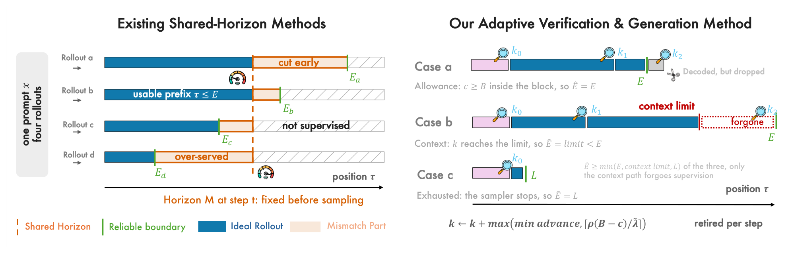

<div align="center">

## Flash-OPD: Fast On-Policy Distillation

Flash-OPD accelerates on-policy distillation by **verifying each trajectory's reliable supervision boundary during generation instead of committing to a shared rollout horizon before it**. Generation and teacher verification are interleaved, and every trajectory stops on its own observed teacher–student compatibility events — giving **2.2×–7.5× faster training** than full-horizon OPD at equal or better average accuracy.

<p align="center">
  <a href="https://arxiv.org/abs/2610.06105"></a>
  <a href="https://onedean.github.io/Flash-OPD-Site"></a>
  <a href="https://github.com/Onedean/Flash-OPD"></a>
  <a href="LICENSE"></a>
</p>

</div>

## 🔥 News

- **[10/2026]** Paper is on [arXiv](https://arxiv.org/abs/2610.06105) and the training code is released!

## 📊 Overview

<div align="center">

</div>

OPD gives a student dense teacher supervision on its own trajectories, but most of the cost goes into generating and scoring positions the teacher can no longer supervise reliably. Existing accelerations pick one rollout horizon for the whole batch, either open-loop or adapted at runtime. Reliable lengths differ **between trajectories of the same prompt**, so one horizon either truncates useful supervision or pays for tokens past the reliable region.

Flash-OPD replaces horizon control with per-trajectory boundary verification: it interleaves cached generation with teacher verification and retires each trajectory independently, based on the compatibility events actually observed in its prefix. Estimation is used only to schedule the next verification point, never to decide stopping, so estimation error costs extra generation or checks rather than lost supervision. In the code the mechanism is named **ICT** (Iterative Checkpoint Truncation) — see [`docs/verl_changes.md`](docs/verl_changes.md) for the implementation map.

Full results, ablations and analysis are in the [paper](https://arxiv.org/abs/2610.06105).

## 📂 Repository Layout

```text
Flash-OPD/
  verl/                       # Vendored verl fork containing the method
    verl/utils/ict.py         #   boundary-verification controller
    verl/utils/ict_loop.py    #   generate <-> verify batch assembly
  experiments_scripts/
    common.sh                 # Shared Hydra command builder; DRY_RUN=1 previews it
    flash-opd.sh              # Controller knobs, shared by the four wrappers
    flash-opd-g{1..4}-*.sh    # The four reported Flash-OPD configurations
    opd-g{1..4}-*.sh          # The four OPD baselines
  tests/                      # Controller + batch-assembly tests, no GPU needed
  datasets/                   # All training and evaluation data used in the paper
  docs/verl_changes.md        # What was changed in verl, and what ships inert
```

## 📦 Installation

A CUDA 12 machine with 8 GPUs. Training is built on [verl](https://github.com/volcengine/verl), vendored here in full so an editable install works against the tree you cloned.

```bash
git clone https://github.com/Onedean/Flash-OPD.git && cd Flash-OPD

conda create -n opd python=3.12 -y && conda activate opd

cd verl && USE_MEGATRON=0 bash scripts/install_vllm_sglang_mcore.sh && cd ..
pip install -e ./verl
pip install math-verify
```

- **FlashAttention wheel mismatch:** if the wheel chosen by `verl/scripts/install_vllm_sglang_mcore.sh` does not match your CUDA/PyTorch platform, install the matching wheel yourself and rerun the remaining pip installs.
- **No extra data download:** everything the paper evaluates on is already in `datasets/`.

## 📚 Data

`datasets/` is what `DATA_ROOT` defaults to. Nothing needs downloading or preprocessing.

| Path | Role |
| --- | --- |
| `datasets/dapo-math-17k.parquet` | training prompts |
| `datasets/test_data/{AMC23,AIME24,AIME25,HMMT24,HMMT25}/test.parquet` | in-domain evaluation (launcher default) |
| `datasets/test_data/{MATH-500,Minerva,Olympiad-Bench,GPQA}/test.parquet` | transfer evaluation, full sets |
| `datasets/test_data/{MATH-500,Minerva,Olympiad-Bench,GPQA}/ood250/test.parquet` | transfer evaluation, the 250-prompt subsets the paper reports |

The five in-domain sets must exist — `common.sh` checks for them before launching. Transfer sets are not evaluated by default. `ood250/` ships as data rather than as a sampling script so the subset is exactly the reported one:

```bash
TEST_DATASET='["datasets/test_data/MATH-500/ood250/test.parquet","datasets/test_data/Minerva/ood250/test.parquet","datasets/test_data/Olympiad-Bench/ood250/test.parquet","datasets/test_data/GPQA/ood250/test.parquet"]' \
VAL_N_RESPONSES=4 bash experiments_scripts/flash-opd-g4-qwen3-4b-base-qwen3-4b.sh
```

> `VAL_N_RESPONSES` drops to 4 so one generation budget covers 948 prompts instead of 203. Lowering it is only valid when **both** arms of a comparison lower it together.

## 🤗 Models

Weights are not in this repository. Place them under `MODEL_ROOT` (default `./models`) using these directory names, or point `ACTOR_MODEL_PATH` / `REWARD_MODEL_PATH` at absolute paths.

| Directory | Source |
| --- | --- |
| `DeepSeek-R1-Distill-Qwen-1.5B` | [`deepseek-ai/DeepSeek-R1-Distill-Qwen-1.5B`](https://huggingface.co/deepseek-ai/DeepSeek-R1-Distill-Qwen-1.5B) |
| `DeepSeek-R1-Distill-Qwen-7B` | [`deepseek-ai/DeepSeek-R1-Distill-Qwen-7B`](https://huggingface.co/deepseek-ai/DeepSeek-R1-Distill-Qwen-7B) |
| `JustRL-DeepSeek-1.5B` | released with JustRL ([arXiv:2512.16649](https://arxiv.org/abs/2512.16649)) |
| `Qwen3-1.7B-Base` | [`Qwen/Qwen3-1.7B-Base`](https://huggingface.co/Qwen/Qwen3-1.7B-Base) |
| `Qwen3-4B-Base` | [`Qwen/Qwen3-4B-Base`](https://huggingface.co/Qwen/Qwen3-4B-Base) |
| `Qwen3-4B` | [`Qwen/Qwen3-4B`](https://huggingface.co/Qwen/Qwen3-4B) |

## 🚀 Quickstart

Each wrapper pins one reported configuration; nothing needs to be passed on the command line.

```bash
# Flash-OPD on G3 (the fastest of the four pairs)
bash experiments_scripts/flash-opd-g3-qwen3-1.7b-base-qwen3-4b.sh

# Its OPD baseline
bash experiments_scripts/opd-g3-qwen3-1.7b-base-qwen3-4b.sh
```

Preview the resolved Hydra command without launching anything:

```bash
DRY_RUN=1 bash experiments_scripts/flash-opd-g3-qwen3-1.7b-base-qwen3-4b.sh
```

Extra Hydra overrides are appended to the command:

```bash
bash experiments_scripts/flash-opd-g2-r1-1.5b-r1-7b.sh \
    trainer.test_freq=10 actor_rollout_ref.actor.optim.lr=5e-7
```

## ⚡ Training

| Pair | Student | Teacher | Flash-OPD (ours) | OPD baseline |
| --- | --- | --- | --- | --- |
| G1 | R1-Distill-Qwen-1.5B | JustRL-DeepSeek-1.5B | `flash-opd-g1-r1-1.5b-justrl-1.5b.sh` | `opd-g1-r1-1.5b-justrl-1.5b.sh` |
| G2 | R1-Distill-Qwen-1.5B | R1-Distill-Qwen-7B | `flash-opd-g2-r1-1.5b-r1-7b.sh` | `opd-g2-r1-1.5b-r1-7b.sh` |
| G3 | Qwen3-1.7B-Base | Qwen3-4B (non-thinking) | `flash-opd-g3-qwen3-1.7b-base-qwen3-4b.sh` | `opd-g3-qwen3-1.7b-base-qwen3-4b.sh` |
| G4 | Qwen3-4B-Base | Qwen3-4B (non-thinking) | `flash-opd-g4-qwen3-4b-base-qwen3-4b.sh` | `opd-g4-qwen3-4b-base-qwen3-4b.sh` |

> This release contains **OPD** and **Flash-OPD**; the paper's other baselines are not part of it.

> The OPD baseline is the **absence** of configuration: it calls the same `run_opd` with no `actor_rollout_ref.rollout.prune_opd` overrides, so the subtree is never created and the trainer takes the stock full-horizon path. There is no flag that turns Flash-OPD off — run a baseline under `DRY_RUN=1` and no `prune_opd` key appears.

### Controller settings

G1 is the only pair where the controller is retuned; G2–G4 use the defaults in `flash-opd.sh`. All four share allowance *B* = 200, threshold η = 0.70, step discount ρ = 1.00.

| | Max rollout | *k₀* | *W* | *k*<sub>min</sub> | *L*<sub>max</sub> | Other |
| --- | --- | --- | --- | --- | --- | --- |
| G1 | 12288 | 1024 | 1024 | 512 | 4400 | reuse of verification outputs on |
| G2 | 12288 | 128 | 128 | 16 | 12288 | |
| G3 | 8192 | 128 | 128 | 16 | 8192 | non-thinking template |
| G4 | 12288 | 128 | 128 | 16 | 12288 | non-thinking template |

> `L_max` defaults to the rollout budget, which makes it inert. Set below the boundary — as on G1 — it becomes a real retention cap and is the only path that stops a trajectory before its verified boundary.

### Shared settings

| | |
| --- | --- |
| Training steps | 203, one epoch, prompt shuffling on |
| Batch / mini-batch | 64 prompts, 4 samples per prompt |
| Learning rate | 1e-6, constant |
| Max prompt length | 1024 tokens |
| Parameter dtype | fp32 |
| Loss aggregation | token mean |
| KL penalty, format reward | disabled |
| Advantage estimator | `token_reward_direct` |
| Candidate set / weights | student top-16 / student probabilities |
| Student / teacher temperature | 1.0 / 1.0 |
| Verification micro-batch | 4096 tokens |
| Rollout engine memory fraction | 0.6, engine held resident across rounds |

Two settings are easy to get wrong:

- **`GPU_MEM_UTIL=0.6` goes with `ICT_HOLD_AWAKE=True`.** Holding the rollout engine resident across verification rounds is what makes the method affordable, but the engine keeps its memory reservation while the verification forwards run, so they need headroom. 0.6 is the reported setting; 0.8 runs out of memory in `compute_log_prob`.
- **`APPLY_CHAT_TEMPLATE_ENABLE_THINKING=False` is mandatory for a Qwen3-Base student** (G3, G4). Left unset, Qwen3 defaults to thinking on, the base student emits a very long chain, hits the evaluation cap and never writes `\boxed{}` — the score then measures parse failure, not reasoning. The wrappers set it.

### Logging

Console-only by default. For W&B, pass the key through the environment — nothing here stores one:

```bash
WANDB_API_KEY=<your-key> WANDB_MODE=online TRACKING_BACKENDS='[console,wandb]' \
bash experiments_scripts/flash-opd-g2-r1-1.5b-r1-7b.sh
```

Flash-OPD runs log a `prune_opd/*` group describing what the controller did:

| Metric | Reading |
| --- | --- |
| `prune_opd/rounds` | verification rounds this step; 1 means the loop never iterated |
| `prune_opd/len_{mean,min,max}` | retained length across the batch |
| `prune_opd/decode_overshoot` | tokens decoded but not retained |
| `prune_opd/verify_amplification` | positions sent to the teacher per position kept |
| `prune_opd/stop_allowance` | trajectories retired at their verified boundary — the intended path |
| `prune_opd/stop_context` | trajectories that hit `L_max` instead |
| `prune_opd/stop_exhausted` | trajectories that finished generating before the allowance |
| `timing_s/{gen_ict,verify_ict}` | the two halves of the loop's wall clock |

> The three `stop_*` counts partition the batch, so they are the quickest health check: `rounds > 1` with `stop_allowance > 0` means trajectories are retiring at verified boundaries rather than at a shared horizon.

## 🎓 Evaluation

There is no separate evaluation script: benchmarks are evaluated **inside training** every `TEST_FREQ` steps (20 by default), which is how the reported curves and tables are produced. Defaults are mean@16 at 31744 tokens, temperature 1.0, top-*p* 0.95, over the five in-domain sets.

```bash
# Evaluate before training starts, then every 10 steps
VAL_BEFORE_TRAIN=True TEST_FREQ=10 \
bash experiments_scripts/flash-opd-g3-qwen3-1.7b-base-qwen3-4b.sh
```

Per-sample generations are written to `validation_log/<experiment_name>/`.

## 🧪 Tests

The controller and the batch assembly around it are tested without a GPU, a model, or a cluster:

```bash
python -m pytest tests/ -q
```

`tests/test_ict.py` sweeps the stopping rule over ρ × *W* × *k₀* × *k*<sub>min</sub> and asserts both halves of the claim: the retained length never falls below the true usable length, and it does not depend on ρ at all. `tests/test_ict_loop.py` pins the tensor invariants whose violations are silent — padding side, per-request budgets, and row order across rounds.

## 📝 Citation

```bibtex
@misc{chen2026flashopd,
      title={Flash-OPD: Fast On-Policy Distillation},
      author={Wei Chen and Junle Chen and Yitong Yang and Zhaoyang Xu and Jiaxin Lin and Yuxuan Liang and Xiaofang Zhou and Kai Wang and Rui Chen},
      year={2026},
      eprint={2610.06105},
      archivePrefix={arXiv},
      primaryClass={cs.LG},
      url={https://arxiv.org/abs/2610.06105},
}
```

## 🙏 Acknowledgments

Built on the [verl](https://github.com/volcengine/verl) training framework, with the on-policy distillation implementation adapted from [THUNLP/OPD](https://github.com/thunlp/OPD) and [Prune-OPD](https://github.com/yangzhch6/Prune-OPD), whose token-level top-*k* overlap criterion Flash-OPD reuses as its compatibility signal and compares against as a baseline. We really appreciate their contributions to the community.
